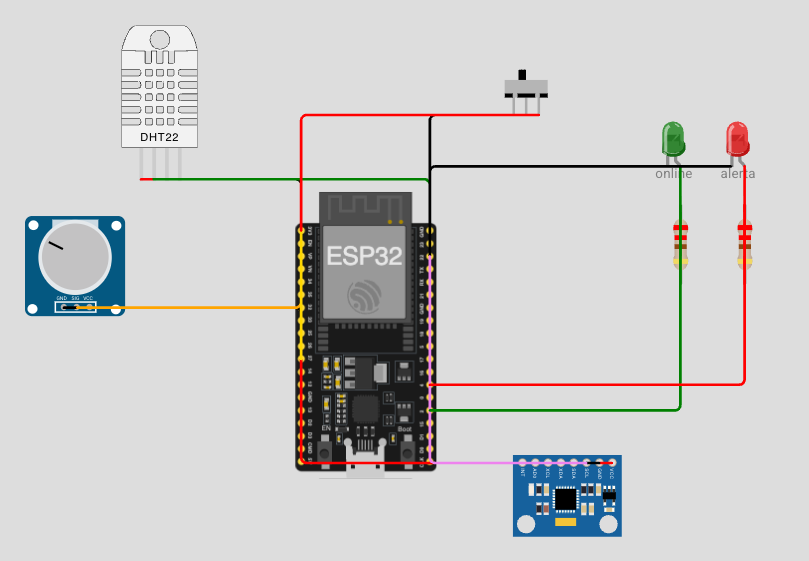
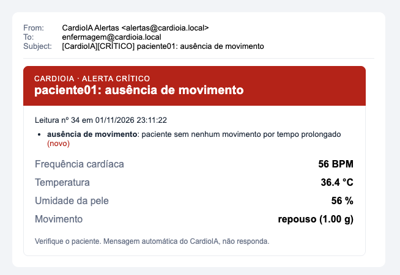
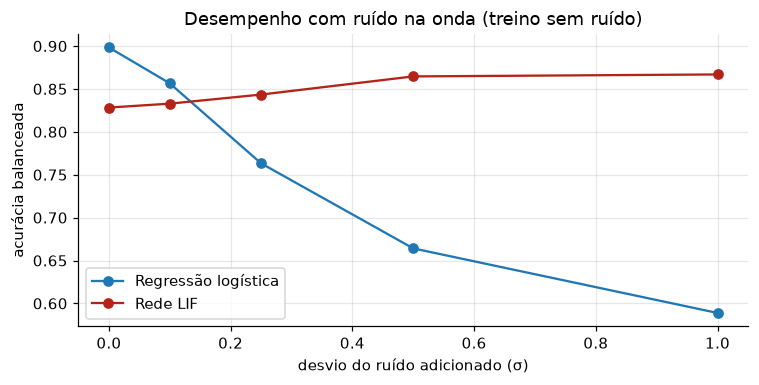

# CardioIA — Fase 3: Monitoramento Contínuo (IoT, Edge e Nuvem)

> **Fases do projeto:** [Fase 1 — Batimentos de Dados](../README.md) ·
> [Fase 2 — Diagnóstico Automatizado](../fase2/README.md) · Fase 3 (este documento)

Projeto acadêmico FIAP. Nesta fase o CardioIA vira um vestível simulado:
um ESP32 que captura sinais vitais, processa e guarda os dados localmente,
transmite para a nuvem e alimenta dashboards com alertas.

## 👨‍🎓 Integrantes
- Victor Copque dos Reis — RM566821
- Victor Hugo Ferreira Rolim — RM568006

## 📌 O que está entregue

| Parte | Entregável | Arquivo |
|---|---|---|
| 1 | Projeto no Wokwi | https://wokwi.com/projects/479413654575407105 |
| 1 | Código C++ comentado (ESP32) | [`parte1/sketch.ino`](parte1/sketch.ino) |
| 1 | Circuito do Wokwi e tabela de partições (cria a área do SPIFFS) | [`parte1/diagram.json`](parte1/diagram.json) · [`parte1/partitions.csv`](parte1/partitions.csv) |
| 1 | Relatório: fluxo de funcionamento e lógica de resiliência | [`parte1/RELATORIO.pdf`](parte1/RELATORIO.pdf) · [`parte1/RELATORIO.md`](parte1/RELATORIO.md) |
| 2 | Projeto no Wokwi (ESP32 publicando por MQTT) | https://wokwi.com/projects/479418030587973633 |
| 2 | Código do ESP32 com MQTT | [`parte2/sketch.ino`](parte2/sketch.ino) |
| 2 | Fluxo e dashboard do Node-RED (export) | [`parte2/node-red/flows.json`](parte2/node-red/flows.json) |
| 2 | Prints da dashboard, do fluxo e do Wokwi | [`parte2/prints/`](parte2/prints/) |
| 2 | Relatório: fluxo de comunicação MQTT e configuração da dashboard | [`parte2/RELATORIO.pdf`](parte2/RELATORIO.pdf) · [`parte2/RELATORIO.md`](parte2/RELATORIO.md) |
| Ir Além 1 | API REST e cliente em Python, verificação de risco e e-mail automático | [`ir_alem_1/`](ir_alem_1/README.md) |
| Ir Além 1 | Relatório: fluxo implementado | [`ir_alem_1/RELATORIO.pdf`](ir_alem_1/RELATORIO.pdf) · [`ir_alem_1/RELATORIO.md`](ir_alem_1/RELATORIO.md) |
| Ir Além 2 | Notebook: regressão logística × rede neuromórfica LIF em séries de batimentos | [`ir_alem_2/series_temporais_lif.ipynb`](ir_alem_2/series_temporais_lif.ipynb) |
| Ir Além 2 | Relatório comparativo e vídeo | [`ir_alem_2/RELATORIO.pdf`](ir_alem_2/RELATORIO.pdf) · [`ir_alem_2/README.md`](ir_alem_2/README.md) |

## Parte 1 — Edge Computing

ESP32 com **DHT22** (temperatura e umidade), **potenciômetro** simulando o
sensor de pulso (BPM) e **MPU6050** (movimento e queda). Toda leitura é
classificada no próprio dispositivo (alertas de bradicardia, taquicardia
conforme o movimento, febre, hipotermia e queda), gravada em CSV no **SPIFFS**
e enviada à "nuvem" (`Serial.println`) quando a chave de Wi-Fi está ligada.
Depois do envio, o arquivo local é apagado.

**Resiliência offline:** sem conexão a coleta continua, e ao reconectar tudo é
sincronizado em ordem. Se a conexão cair no meio do envio, o que faltou volta
para o buffer. O buffer comporta **24 h offline (8.640 leituras)**. Quando
enche, as leituras com alerta são todas mantidas e metade das normais é
descartada, para não perder justamente o episódio clínico. Detalhes no
[relatório](parte1/RELATORIO.md).



### O circuito explicado bem simples

Pense no circuito como **um relógio inteligente de hospital** que fica no
pulso do paciente.

#### As peças

**🧠 ESP32: o cérebro.** A placa preta grandona do meio, um computadorzinho do
tamanho de um chiclete. Ela pergunta aos sensores "e aí, como tá o paciente?",
decide se aquilo é normal ou preocupante, anota tudo num caderninho e manda as
anotações para o médico quando tem internet. Os furinhos nas laterais são os
**pinos**, as "portas" por onde ela conversa com cada peça.

**🌡️ DHT22: o termômetro.** A caixinha branca com furinhos. Mede
**temperatura** (o paciente está com febre?) e **umidade** (está suando muito?).
É o sensor que o enunciado exige.

**🎛️ Potenciômetro: o "coração de mentirinha".** O botão redondo azul que
gira, igual ao de volume de um rádio antigo. O Wokwi não tem sensor de
batimento, então **fingimos**: girou para um lado, o coração bate devagar;
girou para o outro, bate rápido. O ESP32 converte a posição do botão em BPM
(de 30 a 200).

**📱 MPU6050: o detector de chacoalhão.** A plaquinha pequena embaixo. É o
mesmo sensor que faz a tela do celular girar quando você deita o aparelho. Ele
sente se o paciente está **parado** (só a gravidade, ~1 g), **se mexendo**
(andando, correndo) ou **caindo** (um tranco forte, acima de 2,5 g).

**🔀 Chave deslizante: o "botão da internet".** Não existe Wi-Fi de verdade
aqui; a chave **finge** a conexão. Para um lado, "estou com internet"; para o
outro, "fiquei sem sinal". Serve para mostrar o que acontece quando o paciente
fica sem conexão.

**💡 LED verde: "estou online".** Aceso quer dizer que tem internet.

**🔴 LED vermelho: "ALERTA!"** Acende quando a última leitura foi
preocupante: coração muito rápido ou muito lento, febre, frio demais ou queda.

**〰️ Resistores: os redutores de velocidade.** As pecinhas listradas abaixo dos
LEDs. Seguram a corrente para o LED não "queimar" por receber energia demais.

**🔌 Os fios.** O **vermelho** é a energia (3,3 V), a "comida" das peças. O
**preto** é o terra (GND), o "caminho de volta" da energia; sem ele o circuito
não fecha. Os **coloridos** (verde, laranja, azul…) são os fios de
**conversa**: por eles o sensor conta ao ESP32 o que mediu.

#### A historinha do que acontece

A cada 2 segundos o ESP32 faz isto:

1. **Pergunta a todo mundo:** "Termômetro, quanto tá? Coração, quantas
   batidas? Detector, ele tá parado ou se mexendo?"
2. **Pensa sozinho.** Essa é a parte "Edge": o próprio aparelho decide, sem
   precisar da internet. Exemplo: "140 batidas… mas ele está **correndo**,
   então tudo bem." Se estivesse **deitado** com 140, seria alerta e o LED
   vermelho acenderia.
3. **Anota no caderninho**, que é o **SPIFFS**, um arquivo dentro da memória
   do ESP32. **Sempre** anota, com ou sem internet.
4. **Se tem internet**, lê o caderninho inteiro para o médico (aqui, imprime no
   Monitor Serial com `[NUVEM]`) e **arranca as páginas** que já foram
   entregues.

#### E quando acaba a internet?

O aparelho **não para**. Continua medindo e anotando no caderninho. Quando a
internet volta, entrega tudo de uma vez, na ordem certa.

**E se o caderninho encher?** Imagine 24 horas sem internet: o caderno tem
espaço para 8.640 anotações. Se lotar, o aparelho não joga fora as mais velhas
no chute. Ele **guarda TODAS as anotações de alerta** ("às 3 da manhã o coração
disparou"), porque é isso que o médico precisa ver. Das anotações normais
("tudo ok, tudo ok, tudo ok…"), **joga fora uma sim, uma não**: continua dando
para ver o dia inteiro, só com menos detalhe.

No modo demonstração o caderno tem só 20 linhas, e dá para ver isso acontecer
em menos de 1 minuto.

#### Os arquivos do projeto

| Arquivo | O que é, bem simples |
|---|---|
| `sketch.ino` | As **instruções** que o cérebro segue (o código em C++) |
| `diagram.json` | A **planta** do circuito: que peças existem e onde cada fio liga |
| `libraries.txt` | Os **manuais** das peças (como conversar com o DHT22 e com o MPU6050) |
| `partitions.csv` | O **mapa da memória**: separa um pedaço para o caderninho (SPIFFS). Sem ele o caderninho não existe |

> **Resumo numa frase:** um relógio de pulso que mede febre, batimento e
> quedas, decide sozinho se algo está errado, guarda tudo num caderninho
> quando está sem internet e entrega tudo ao médico quando a internet volta,
> sem perder os momentos de perigo.

### Como rodar no Wokwi

1. Em [wokwi.com](https://wokwi.com), crie um projeto **ESP32** novo.
2. Substitua o conteúdo de `sketch.ino` e `diagram.json` pelos desta pasta.
3. Crie o arquivo `partitions.csv` (menu ▾ ao lado das abas → *New file...*)
   com o conteúdo desta pasta. Sem ele, o ESP32 do Wokwi não tem partição de
   dados e o SPIFFS falha com `spiffs partition could not be found`.
4. Em **Library Manager**, adicione as bibliotecas de `libraries.txt`.
5. Inicie a simulação e use os controles:
   - **chave deslizante:** liga e desliga o Wi-Fi;
   - **potenciômetro:** muda o BPM;
   - **DHT22:** clique nele e altere a temperatura;
   - **MPU6050:** clique nele e altere a aceleração (acima de 2,5 g simula
     uma queda).

### Roteiro de demonstração: como mexer em cada sensor

O ESP32 só **lê** os sensores; quem muda o "mundo real" na simulação é você,
mexendo nas peças. O circuito começa numa situação **sem alerta**: 74 BPM,
36,6 °C e paciente em repouso. Para cada situação, ajuste as peças assim e
acompanhe o resultado no Monitor Serial e no LED vermelho:

| Situação | Potenciômetro (BPM) | DHT22 (clique na peça) | MPU6050 (clique na peça) | Resultado esperado |
|---|---|---|---|---|
| **Normal** (estado inicial) | ~26% do giro → ~74 BPM | 36,6 °C | aceleração Z = 1 g, X e Y = 0 | sem alerta, LED vermelho apagado |
| **Taquicardia em repouso** | ~80% do giro → ~165 BPM | 36,6 °C | Z = 1 g | `ALERTA: taquicardia` |
| **Febre** | ~74 BPM | **38,6 °C** | Z = 1 g | `ALERTA: febre` |
| **Hipotermia** | ~74 BPM | **34,5 °C** | Z = 1 g | `ALERTA: hipotermia` |
| **Correndo: FC alta sem alarme** | ~65% do giro → ~140 BPM | 36,6 °C | **Z = 1,5 g** (atividade) | **sem alerta**: em atividade o limite sobe para 150 BPM |
| **Mesma FC, deitado** | ~140 BPM | 36,6 °C | volte Z para 1 g | `ALERTA: taquicardia`, mostrando que o contexto muda a decisão |
| **Bradicardia** | ~6% do giro → ~40 BPM | 36,6 °C | Z = 1 g | `ALERTA: bradicardia` |
| **Queda** | ~74 BPM | 36,6 °C | **Z = 3 g** (impacto) | `ALERTA: queda` |

O BPM aparece em cada linha `[LEITURA]`, então é só girar o potenciômetro
até o número desejado. Para voltar ao normal, desfaça os ajustes da tabela.

**Sequência sugerida para o vídeo:**
1. Com o Wi-Fi **desligado**, mostre algumas leituras normais sendo gravadas
   no SPIFFS (`[OFFLINE] ... no buffer`).
2. Gire o potenciômetro até ~165 BPM: o LED vermelho acende e aparece
   `ALERTA: taquicardia`. Volte para ~74 BPM.
3. Deixe o buffer chegar a 20 registros e mostre a compactação
   (`[EDGE] Decimação ... alertas preservados`).
4. Ligue o Wi-Fi na chave: tudo é enviado com `[NUVEM]`, os alertas
   continuam lá, e o arquivo local é apagado.
5. (Opcional) Mostre o caso "correndo × deitado" para explicar o
   processamento com contexto no Edge.

O modo demonstração (`MODO_DEMO true`) faz uma leitura a cada 2 s e usa um
buffer de 20 registros, para a compactação aparecer rápido. Com `false`, o
código usa os parâmetros de produção (10 s e 8.640 registros).

### Compilar localmente (opcional)

```bash
arduino-cli core install esp32:esp32
arduino-cli lib install "DHT sensor library" "Adafruit MPU6050"
mkdir -p /tmp/cardioia_edge && cp fase3/parte1/sketch.ino /tmp/cardioia_edge/cardioia_edge.ino
arduino-cli compile --fqbn esp32:esp32:esp32 /tmp/cardioia_edge
```

---

## Parte 2 — Transmissão para a nuvem e visualização (Fog/Cloud)

O vestível passa a publicar de verdade por **MQTT** no broker público
`broker.hivemq.com`, e um **Node-RED** com o Dashboard 2.0 mostra tudo em tempo
real. O batimento agora vem de um **botão de pulso**: cada aperto é uma batida,
e o ESP32 calcula o BPM pela média dos intervalos.


- **Gráfico** de batimentos com a linha do limite de 120 BPM, e outro de
  temperatura.
- **Gauge** de temperatura com faixas de hipotermia, normal, febre e febre alta.
- **Indicador de alerta**: faixa verde "Sinais normais" ou vermelha
  "ALERTA: motivo", que pisca.
- **Status do dispositivo** online/offline, publicado pelo *Last Will* do MQTT.
- Sem conexão, as leituras ficam na fila do SPIFFS e são reenviadas ao
  reconectar; o gráfico preenche o buraco no horário certo.

Instruções completas, tópicos e prints: [`parte2/README.md`](parte2/README.md).
Relatório: [`parte2/RELATORIO.pdf`](parte2/RELATORIO.pdf).

## Ir Além 1 — API REST e e-mail automático

Uma **API REST em Python** (Flask + SQLite) recebe as leituras do vestível,
verifica o risco (taquicardia, bradicardia, febre, hipotermia, queda e
**ausência de movimento**, que depende do histórico e por isso só a nuvem
consegue detectar) e **dispara um e-mail** para a enfermagem quando surge um
alerta novo. Um cliente com `requests` simula o vestível e consulta a API.

```bash
cd fase3/ir_alem_1 && pip install -r requirements.txt
python api.py                 # terminal 1
python cliente.py simular     # terminal 2: 40 leituras, 5 alertas, 5 e-mails
```



Instruções, rotas e regras: [`ir_alem_1/README.md`](ir_alem_1/README.md).
Relatório: [`ir_alem_1/RELATORIO.pdf`](ir_alem_1/RELATORIO.pdf).

## Ir Além 2 — IA em séries temporais: regressão logística × rede LIF

Com batimentos reais do **MIT-BIH** (treino e teste com pacientes diferentes),
comparamos uma **regressão logística** com uma **rede neuromórfica de 300
neurônios LIF**, as duas com a mesma entrada: a onda do batimento e a série
dos intervalos RR. Com sinal limpo, a regressão logística vence (acurácia
balanceada 0,898 × 0,828). Com ruído forte, a LIF se mantém (0,867) e a
regressão logística cai para 0,589. Numa CPU, a LIF custa ~1.000× mais.



Notebook, resultados e vídeo: [`ir_alem_2/README.md`](ir_alem_2/README.md).
Relatório: [`ir_alem_2/RELATORIO.pdf`](ir_alem_2/RELATORIO.pdf).
