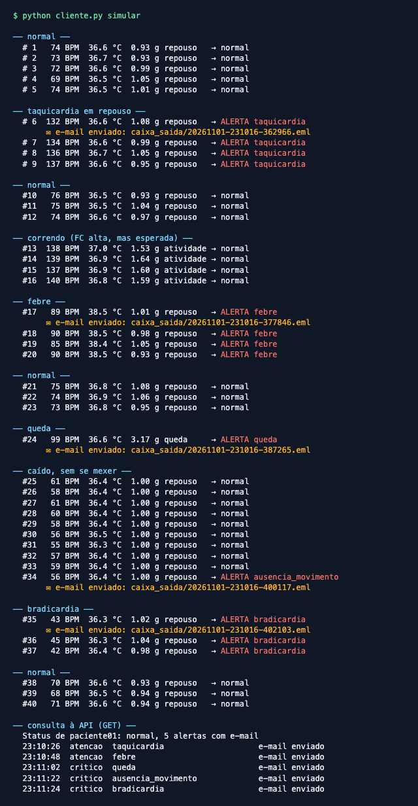

# CardioIA — Fase 3, Ir Além 1: API REST e e-mail automático

> [← Fase 3](../README.md) · Relatório: [`RELATORIO.pdf`](RELATORIO.pdf) ([`.md`](RELATORIO.md))

O vestível manda cada leitura para uma **API REST em Python**. A API verifica o
risco (taquicardia, bradicardia, febre, hipotermia, queda e **ausência de
movimento**), guarda tudo e, quando aparece um alerta novo, **dispara um e-mail**
para a enfermagem sem ninguém precisar clicar em nada.

```
cliente.py ──POST /leituras──►  api.py  ──►  risco.py  ──alerta novo?──►  notificador.py ──► e-mail
(vestível)                   (Flask+SQLite)  (regras)                    (.eml ou SMTP)
cliente.py ◄──GET /leituras, /alertas, /status──┘
(enfermagem)
```

## O que tem aqui

| Arquivo | O que faz |
|---|---|
| [`api.py`](api.py) | API REST (Flask): recebe, valida, classifica e guarda as leituras no SQLite; consulta de leituras, alertas e status |
| [`risco.py`](risco.py) | lógica de verificação de risco, com os mesmos limiares do ESP32 |
| [`notificador.py`](notificador.py) | monta o e-mail (texto + HTML) e entrega em arquivo `.eml` ou por SMTP |
| [`cliente.py`](cliente.py) | cliente REST (`requests`): simula o vestível e consulta a API; fila local se a API cair |
| [`prints/`](prints/) | saída da simulação e o e-mail gerado |
| [`../tests/test_ir_alem1_rest.py`](../tests/test_ir_alem1_rest.py) | 24 testes: regras, rotas, e-mail, cliente contra a API rodando |

## Como rodar

```bash
cd fase3/ir_alem_1
pip install -r requirements.txt

python api.py                 # terminal 1: API em http://127.0.0.1:5050
python cliente.py simular     # terminal 2: roda o roteiro de situações
```

Os e-mails ficam em `caixa_saida/` (arquivos `.eml`: dois cliques abrem no
Mail ou no Outlook). Outros comandos do cliente:

```bash
python cliente.py leituras -n 10   # últimas leituras
python cliente.py alertas          # alertas e status de cada e-mail
python cliente.py status           # situação atual do paciente
```

### E-mail por SMTP de verdade

```bash
python -m aiosmtpd -n -l localhost:1025         # servidor SMTP local que imprime o que chega
EMAIL_MODO=smtp python api.py
```

Para mandar por um provedor real (Gmail com senha de app, por exemplo):
`EMAIL_MODO=smtp SMTP_HOST=smtp.gmail.com SMTP_PORTA=587 SMTP_TLS=1
SMTP_USUARIO=... SMTP_SENHA=... EMAIL_DESTINO=voce@exemplo.com python api.py`.
Nenhuma senha fica no código.

## A API

Todas as rotas, exceto `/saude`, exigem o cabeçalho `X-API-Key`
(padrão `cardioia-demo`, troque com `CARDIOIA_API_KEY`).

| Método | Rota | Resposta |
|---|---|---|
| GET | `/api/v1/saude` | `{"status": "ok"}` |
| POST | `/api/v1/leituras` | **201** com a leitura classificada e o resultado do e-mail; **200** se a leitura já tinha chegado; **400** se inválida; **401** sem chave |
| GET | `/api/v1/leituras?paciente=&limite=` | últimas leituras, da mais nova para a mais antiga |
| GET | `/api/v1/alertas?paciente=&limite=` | alertas com os motivos novos e o status do e-mail |
| GET | `/api/v1/pacientes/<id>/status` | última leitura e total de alertas (**404** se não houver leituras) |

```bash
curl -s -X POST http://127.0.0.1:5050/api/v1/leituras \
  -H 'X-API-Key: cardioia-demo' -H 'Content-Type: application/json' \
  -d '{"paciente":"paciente01","seq":1,"ts":1793500000,"temp":36.6,"umid":55,"bpm":135,"acel":1.0}'
```

O corpo é o mesmo JSON que o ESP32 publica por MQTT na Parte 2.

## Regras de risco

| Motivo | Regra | Severidade |
|---|---|---|
| taquicardia | BPM > 120 em repouso, ou > 150 em atividade | atenção |
| febre | temperatura ≥ 37,8 °C | atenção |
| bradicardia | 0 < BPM < 50 (BPM 0 = sem leitura, não alerta) | crítico |
| hipotermia | temperatura ≤ 35 °C | crítico |
| queda | aceleração ≥ 2,5 g | crítico |
| ausência de movimento | 10 leituras seguidas com a aceleração a menos de 0,02 g de 1 g | crítico |

O e-mail sai **só quando aparece um motivo que a leitura anterior não tinha**.
Uma taquicardia que dura dez leituras gera um e-mail, não dez.

## Prints

| Simulação no terminal | E-mail gerado |
|---|---|
|  |  |
