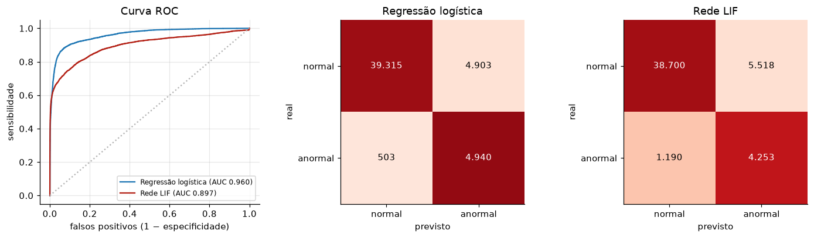

# Relatório — Ir Além 2: regressão logística × rede neuromórfica LIF

**CardioIA — Fase 3** · Victor Copque dos Reis (RM566821) · Victor Hugo Ferreira Rolim (RM568006)

## 1. Problema e dados

Classificar cada batimento como **normal** ou **anormal** a partir da série
temporal do ECG. Usamos o **MIT-BIH Arrhythmia Database** (PhysioNet), com as
classes da norma AAMI: N normal × S, V e F anormais (≈ 10% dos batimentos).
O treino e o teste usam **pacientes diferentes** (divisão de de Chazal, 22 + 22
gravações, ~50 mil batimentos cada), porque sortear batimentos deixaria a
mesma pessoa dos dois lados e inflaria a nota.

Os dois modelos recebem a **mesma entrada**: a janela de 0,65 s ao redor do
pico R (117 amostras, filtrada de 0,5 a 40 Hz) e 5 atributos de ritmo
calculados da série de intervalos RR (anterior, seguinte, média local e duas
razões). Os hiperparâmetros foram escolhidos só por validação cruzada
**agrupada por paciente** no treino; o teste foi usado uma única vez.

## 2. Os modelos

**Regressão logística:** `P(anormal) = σ(w·x + b)`, 123 parâmetros, com peso
maior para a classe rara.

**Rede LIF (reservatório de spikes):** 300 neurônios *Leaky Integrate-and-Fire*
com conexões recorrentes esparsas. A cada amostra, o potencial de membrana
integra a corrente e vaza (`v ← β·v + (1−β)·R·I`, τ = 20 ms); ao cruzar o
limiar, o neurônio dispara um spike e volta a zero. A onda entra amostra por
amostra em dois canais (ON/OFF) e o ritmo, como corrente constante. Uma
regressão logística lê quantos spikes cada neurônio deu em 4 fatias da janela.
Os pesos da rede são fixos e aleatórios; só a leitura é treinada, como em
muitos chips neuromórficos.

## 3. Resultados

| Métrica (teste) | Regressão logística | Rede LIF |
|---|---|---|
| Acurácia balanceada | **0,898** | 0,828 |
| Sensibilidade · especificidade | **0,908** · **0,889** | 0,781 · 0,875 |
| Precisão · F1 | **0,502** · **0,646** | 0,435 · 0,559 |
| AUC | **0,960** | 0,897 |
| Acerto por tipo: S · V · F | **0,898** · **0,983** · 0,327 | 0,526 · 0,961 · **0,503** |
| Só a onda · só o ritmo (acur. bal.) | 0,709 · **0,892** | **0,740** · 0,862 |
| Operações por batimento | **122 MAC** | ~73 mil MAC + ~209 mil somas (7 mil spikes) |
| Treino · inferência por batimento (CPU) | **0,7 s** · **0,1 µs** | 10 s · 120 µs |

**Com sinal limpo, a regressão logística vence.** A diferença está quase toda
nas arritmias **supraventriculares (S)**: a onda delas é quase normal e o que
as denuncia é o ritmo, um batimento que chega cedo. Essa é uma regra linear
(RR anterior curto em relação à média), e é justamente o maior peso aprendido
pela regressão logística. Na LIF, o ritmo entra misturado à onda em 300
neurônios aleatórios e a leitura não recupera a regra com a mesma nitidez. O
ritmo é a parte mais informativa da série: sozinho, já dá 0,892.

**A LIF ganha onde a forma importa e onde há ruído.** Com só a onda, ela supera
a regressão logística (0,740 × 0,709) e acerta mais os batimentos de fusão,
casos em que uma combinação não linear da forma ajuda. E com ruído gaussiano
adicionado à onda do teste, a regressão logística desaba enquanto a LIF se
mantém:

O neurônio funciona como filtro: integra a entrada por 20 ms e ignora o que
não cruza o limiar. Além disso, o ruído retificado vira uma excitação quase
constante, e a rede passa a se apoiar no ritmo, que generaliza bem entre
pacientes. Por isso ela chega a melhorar um pouco (0,867 com σ = 1); não é o
ruído que ajuda.

## 4. Vantagens e limitações

| | Regressão logística | Rede LIF |
|---|---|---|
| **Vantagens** | melhor com sinal limpo; 122 operações por batimento; treino em segundos; pesos interpretáveis | robusta a ruído; captura não linearidades da forma; processa o sinal em fluxo, com memória; em hardware neuromórfico, só gasta energia quando há spike |
| **Limitações** | linear; frágil a ruído (σ = 1 → 0,59); precisa da janela inteira pronta | ~1.000× mais lenta numa CPU; sensível a hiperparâmetros (a escala 2,0 daria 0,874 no teste, mas a validação escolheu 4,0); pouco interpretável; só a leitura aprende |

**Cuidados e limites do estudo.** Só uma semente e uma configuração de rede; a
validação com 22 pacientes é ruidosa; o custo de energia da LIF foi estimado
por contagem de operações, não medido num chip. Uma LIF treinada de ponta a
ponta (gradiente substituto) provavelmente fecharia parte da diferença.

## 5. Conclusão para o CardioIA

No ESP32 do vestível, a escolha é a **regressão logística com atributos de
ritmo**: a melhor com sinal limpo, barata e explicável, desde que o sinal passe
por um controle de qualidade que descarte trechos ruidosos. A **rede LIF** é a
candidata quando o ruído for inevitável (paciente em movimento) ou quando o
dispositivo tiver um coprocessador neuromórfico para monitorar 24 h com pouca
bateria. Uma combinação natural: regressão logística quando o sinal está bom,
LIF quando o controle de qualidade aponta ruído.
