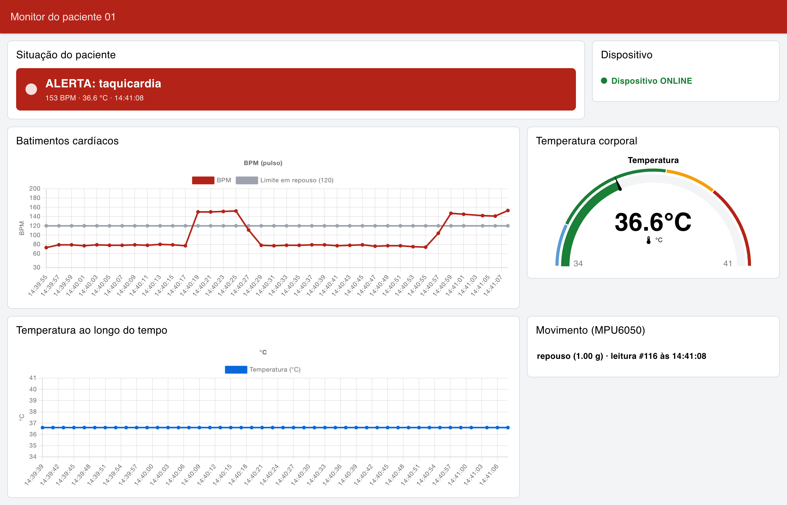
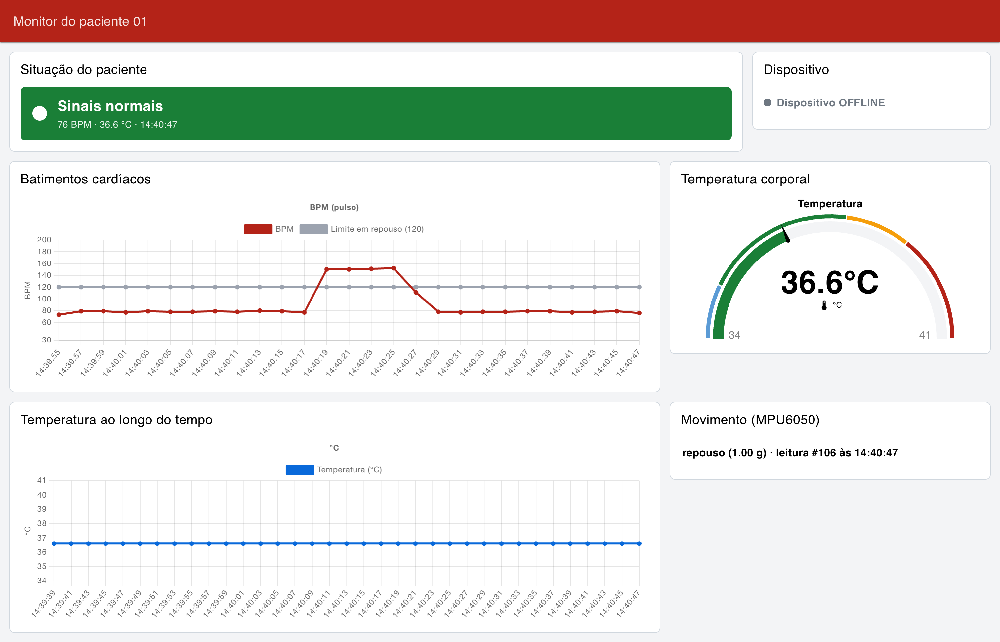
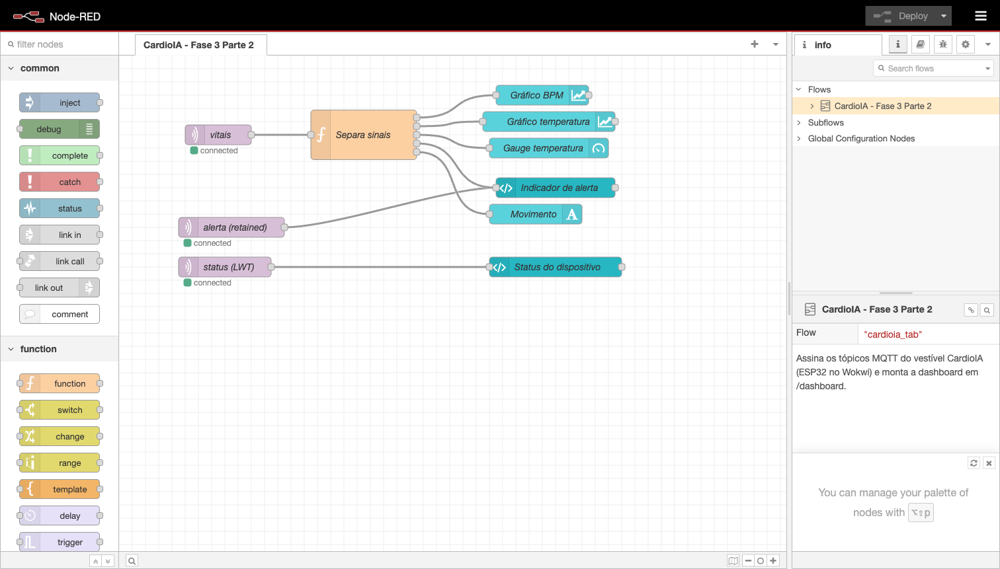
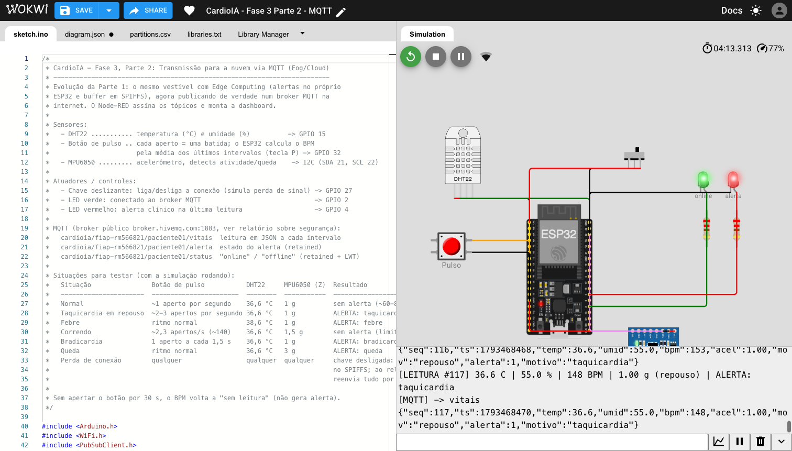

# CardioIA — Fase 3, Parte 2: MQTT e dashboard no Node-RED

> [← Fase 3](../README.md) · Relatório: [`RELATORIO.pdf`](RELATORIO.pdf) ([`.md`](RELATORIO.md))

O vestível da Parte 1 agora publica os sinais vitais por **MQTT** e uma
dashboard no **Node-RED** mostra tudo em tempo real, com alerta automático.

```
ESP32 (Wokwi)  ──MQTT──►  broker.hivemq.com  ──MQTT──►  Node-RED  ──►  Dashboard
   Edge                       Cloud                       Fog          (navegador)
```

## O que tem aqui

| Arquivo | O que é |
|---|---|
| [`sketch.ino`](sketch.ino) | código do ESP32: Wi-Fi, NTP, MQTT, botão de pulso, fila no SPIFFS |
| [`diagram.json`](diagram.json) · [`partitions.csv`](partitions.csv) · [`libraries.txt`](libraries.txt) | circuito, partição do SPIFFS e bibliotecas do Wokwi |
| [`node-red/flows.json`](node-red/flows.json) | fluxo do Node-RED com a dashboard (pode ser importado) |
| [`node-red/package.json`](node-red/package.json) | Node-RED 4 + FlowFuse Dashboard 2.0, com versões fixas |
| [`prints/`](prints/) | evidências: dashboard normal, em alerta e offline, fluxo e Wokwi |

## Tópicos MQTT

Prefixo `cardioia/fiap-rm566821/paciente01/`:

| Tópico | Conteúdo | Retained |
|---|---|---|
| `vitais` | leitura em JSON a cada 2 s (`seq`, `ts`, `temp`, `umid`, `bpm`, `acel`, `mov`, `alerta`, `motivo`) | não |
| `alerta` | estado do alerta, publicado quando muda | sim |
| `status` | `online` / `offline` (também é o *Last Will*) | sim |

Para espiar as mensagens direto do terminal:

```bash
mosquitto_sub -h broker.hivemq.com -t 'cardioia/fiap-rm566821/#' -v
```

## Como rodar

**1. ESP32 no Wokwi.** Abra https://wokwi.com/projects/479418030587973633 e
inicie a simulação. Para montar do zero: crie um projeto ESP32, copie
`sketch.ino`, `diagram.json` e `partitions.csv` (*New file...*) e adicione as
bibliotecas de `libraries.txt` no **Library Manager**.

**2. Node-RED.**

```bash
cd fase3/parte2/node-red
npm install
npm start          # editor em http://127.0.0.1:1880
```

Dashboard: **http://127.0.0.1:1880/dashboard**

**3. Controles no Wokwi.**

- **Chave deslizante:** liga a conexão. O LED verde acende quando o MQTT conecta.
- **Botão vermelho "Pulso"** (ou tecla **P**): cada aperto é uma batida.
  - ~1 aperto por segundo dá ~60 BPM (normal).
  - 2 a 3 apertos por segundo passam de 120 BPM: alerta de taquicardia.
  - Uma pausa de mais de 2,5 s reinicia a medição. Sem apertos por 30 s, o BPM
    volta a "sem leitura".
- **DHT22** e **MPU6050:** clique na peça para mudar a temperatura (38,6 °C dá
  febre) ou a aceleração (Z = 3 g simula queda; Z = 1,5 g é atividade, e o
  limite de BPM sobe para 150).

**Teste de resiliência:** desligue a chave (dashboard: "Dispositivo OFFLINE"),
continue apertando e religue. O ESP32 reenvia a fila e o gráfico preenche o
período offline no horário certo.

## Prints

| Situação normal | Alerta de taquicardia |
|---|---|
|  |  |

| Dispositivo offline | Fluxo no Node-RED |
|---|---|
|  |  |



## Por que broker público

O HiveMQ Cloud não tem mais plano gratuito (o Serverless foi descontinuado;
o Starter é pago após 15 dias de teste). O broker público funciona para a
demonstração, mas não tem senha nem criptografia. Por isso o payload só
identifica `paciente01`. O que mudaria em produção (TLS, autenticação, ACL,
QoS 1) está no relatório.
